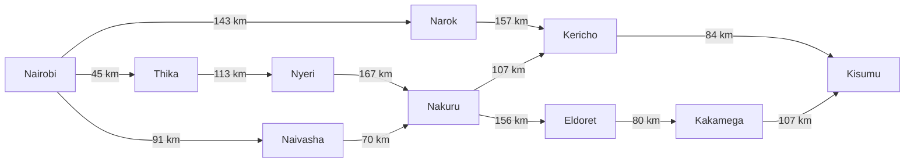
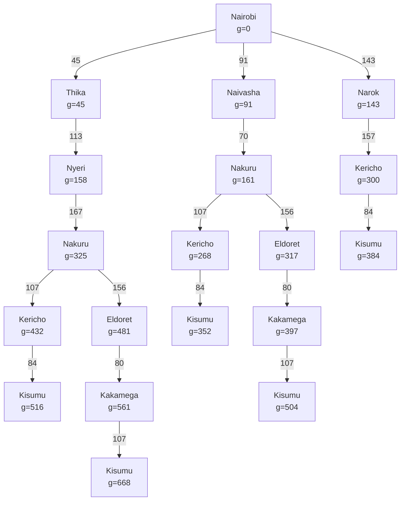

# 1. The self driving Trailer 
Using the PEAS framework this is how this agent can be 

# Performance measure can be observe on :
- Safe arrival with no collisions or damage of the packages 
- A short travel time(on time delivery) and low fuel consumption 
- Following the traffic rules and speed limits 

# Environment the agent will operate in :
- The Kenya Highway for instance Nairobi to Kisumu this journey can include towns,junctions.
- Other vehicles like matatus,motorbikes,pedestrians 
- considering the road condition,weather and police checkpoint 

# Actuators that the agent can have to operate
- The trailer steering
- Accelarator and brakes  
- Gear selection 
- Indicators ,headlights and horn
- Displays units for alerts 

# Sensors that will allow the trailer to communicate with its environment 
- GPS and any digital map data 
- Cameras at the front,back and corners for lane ,signs and obstacles detection 
- A radar(or LiDAR for 3D vision) to compensate the cameras on weather challenges 
- A Speedometer for checking on speed limits and odometer to measure the destination travelled to compare against the GPS information
- Weather and raod surfaces sensors 
- Fuel gauge to allow the agents to know when it needs to refuel 
- Trailer load to keep on check of the packages the trailer can handle without risk  
- Tyre pressure sensors to support on the risk of blowouts 

# Defining more further this agent on its environment properties 

The self driving trailer analysis is as follows :

- It is partially observable: The agent's sensors can't see everything.It can't see around a blind bend on an escarpment, behind a large truck,or know about an accident ahead until it gets close.

- Stochastic :The road has many unpredictable events and uncertainties,the next state is not fully determined  by the agent's action from traffic behaviour ,weather to breakdowns .

- Sequential :because each decision affects the later ones ;The route chosen at Nairobi determines which towns are reachable next ,the speed and lanes choices .All these will affect the overall performance of the agent later 

- Dynamic :because the environment keeps changing while the agent is deciding .

- Continuous :The primary metrics are continuous values rather than discrete for instance speed,position, steering angle ,time 

- Multi-agent:The environment has other agents which are both cooperative and competitive and whose actions are based on their own goals and those actions affect directly whether the trailer will reach its goal safely or not . 

## 2. develop a suitable directed graph and search tree based on the map presented in class of Kenya’s Highway Network

**Abstraction** is where we will remove details that will do not help the agent in deciding its route. In this case this means
- **State:** a state is only the town the trailer is in. Traffic and weather is ignored
- **Actions:** Driving between two towns is treated as 1 action
- **Map:** only major towns where roads join and or split are kept, small towns are left out because the trailer cannot change route there

### The towns(Nodes)
We picked 10 towns that cover all the regions and sit at the highway junctions

| Town     | Region              | Why it was chosen                                 |
|----------|---------------------|---------------------------------------------------|
| Nairobi  | Nairobi             | Start point                                       |
| Thika    | Central Highlands   | Start of the A2 road north                        |
| Nyeri    | Central Highlands   | Main town on the Central route                    |
| Naivasha | Rift Valley         | On the main A104 road west                        |
| Narok    | Rift Valley         | Start of the southern route                       |
| Nakuru   | Rift Valley         | Junction: roads to Kericho and Eldoret split here |
| Kericho  | Rift Valley         | Junction of the Nakuru and Narok routes           |
| Eldoret  | Rift Valley         | Northern route towards Kakamega                   |
| Kakamega | Lake Victoria Basin | Last stop on the northern route                   |
| Kisumu   | Lake Victoria Basin | Goal                                              |

### The roads (Edges)

| From     | To       | Main road | Distance (km) |
|----------|----------|-----------|---------------|
| Nairobi  | Thika    | A2        | 45            |
| Nairobi  | Naivasha | A8        | 91            |
| Nairobi  | Narok    | B3        | 143           |
| Thika    | Nyeri    | A2        | 113           |
| Nyeri    | Nakuru   | B5        | 167           |
| Naivasha | Nakuru   | A8        | 70            |
| Narok    | Kericho  | B3 / C23  | 157           |
| Nakuru   | Kericho  | B1        | 107           |
| Nakuru   | Eldoret  | A8        | 156           |
| Kericho  | Kisumu   | B1        | 84            |
| Eldoret  | Kakamega | A1        | 80            |
| Kakamega | Kisumu   | A1 / A8   | 107           |

### Directed Graph
The edges point from Nairobi to Kisumu because the agent is travelling west and it stops it from going in circles.

===== DIRECTED GRAPH =====

### Search Tree
For the search tree, the root is Nairobi and each town is expanded into the towns it connects to. A branch stops when it reaches kisumu, each box shows the town and g the distance.
Abstraction is applied in this tree because only the junction towns from the graph appear and no branch goes back to a town already in its path

===== SEARCH TREE =====

## 3. Finding the Optimal Path Using Uniform Cost Search (UCS)

We used **Uniform Cost Search (UCS)** to find the shortest route from Nairobi to Kisumu. UCS expands the path with the lowest total cost first.

The path cost, `g(n)`, is calculated by adding the distances travelled from Nairobi to the current town. We choseit also because fo the familiriaty we have with the concept.

### Step 1: Expand Nairobi

| Path | State 0 | State 1 | Cost `g(n)` |
|---|---|---|---:|
| A | Nairobi | Thika | 45 |
| B | Nairobi | Naivasha | 91 |
| C | Nairobi | Narok | 143 |

**Selection:** We selected **Thika (45 km)** because it had the lowest cost.

### Step 2: Expand Thika

Thika leads to Nyeri, adding 113 km: `45 + 113 = 158 km`.

| Path | State 0 | State 1 | State 2 | Cost `g(n)` |
|---|---|---|---|---:|
| B | Nairobi | Naivasha | - | 91 |
| C | Nairobi | Narok | - | 143 |
| D | Nairobi | Thika | Nyeri | 158 |

**Selection:** We selected **Naivasha (91 km)** because it had the lowest cost.

### Step 3: Expand Naivasha

Naivasha leads to Nakuru, adding 70 km: `91 + 70 = 161 km`.

| Path | State 0 | State 1 | State 2 | Cost `g(n)` |
|---|---|---|---|---:|
| C | Nairobi | Narok | - | 143 |
| D | Nairobi | Thika | Nyeri | 158 |
| E | Nairobi | Naivasha | Nakuru | 161 |

**Selection:** We selected **Narok (143 km)** because it had the lowest cost.

### Step 4: Expand Narok

Narok leads to Kericho, adding 157 km: `143 + 157 = 300 km`.

| Path | State 0 | State 1 | State 2 | Cost `g(n)` |
|---|---|---|---|---:|
| D | Nairobi | Thika | Nyeri | 158 |
| E | Nairobi | Naivasha | Nakuru | 161 |
| F | Nairobi | Narok | Kericho | 300 |

**Selection:** We selected **Nyeri (158 km)** because it had the lowest cost.

### Step 5: Expand Nyeri

Nyeri leads to Nakuru, giving a total cost of `45 + 113 + 167 = 325 km`. We discarded this path because Nakuru was already reachable at a lower cost of 161 km.

| Path | State 0 | State 1 | State 2 | Cost `g(n)` |
|---|---|---|---|---:|
| E | Nairobi | Naivasha | Nakuru | 161 |
| F | Nairobi | Narok | Kericho | 300 |

**Selection:** We selected **Nakuru (161 km)** because it had the lowest cost.

### Step 6: Expand Nakuru

Nakuru leads to Kericho and Eldoret.

- Kericho: `161 + 107 = 268 km`.
- Eldoret: `161 + 156 = 317 km`.

The earlier path to Kericho through Narok cost 300 km, so we discarded it and kept the cheaper route through Nakuru.

| Path | State 0 | State 1 | State 2 | State 3 | Cost `g(n)` |
|---|---|---|---|---|---:|
| G | Nairobi | Naivasha | Nakuru | Kericho | 268 |
| H | Nairobi | Naivasha | Nakuru | Eldoret | 317 |

**Selection:** We selected **Kericho (268 km)** because it had the lowest cost.

### Step 7: Expand Kericho

Kericho leads to Kisumu, adding 84 km: `268 + 84 = 352 km`.

| Path | State 0 | State 1 | State 2 | State 3 | State 4 | Cost `g(n)` |
|---|---|---|---|---|---|---:|
| H | Nairobi | Naivasha | Nakuru | Eldoret | - | 317 |
| G | Nairobi | Naivasha | Nakuru | Kericho | Kisumu | 352 |

**Selection:** We selected **Eldoret (317 km)** because it had the lowest cost.

### Step 8: Expand Eldoret

Eldoret leads to Kakamega, adding 80 km: `317 + 80 = 397 km`.

| Path | State 0 | State 1 | State 2 | State 3 | State 4 | Cost `g(n)` |
|---|---|---|---|---|---|---:|
| G | Nairobi | Naivasha | Nakuru | Kericho | Kisumu | 352 |
| H | Nairobi | Naivasha | Nakuru | Eldoret | Kakamega | 397 |

**Selection:** We selected **Kisumu (352 km)** because it had the lowest cost. Since Kisumu is the goal, UCS terminates.

### Final Result

The optimal path found by Uniform Cost Search is:

**Nairobi → Naivasha → Nakuru → Kericho → Kisumu**

Total distance:

`91 + 70 + 107 + 84 = 352 km`

### Group Meeting Evidence

